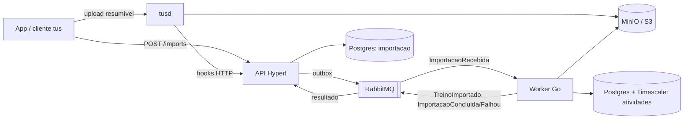

# athlete-training-platform


Plataforma de treino inteligente para atletas amadores com Apple Watch.

## O problema

Quem treina triatlo acumula dados em vários lugares: o Apple Watch (app Saúde), o ciclocomputador e plataformas de treino, cada um em um formato. Transformar isso em carga de treino comparável e em treinos ajustados ao momento do atleta é trabalho manual. A plataforma importa os treinos de todas as fontes, normaliza num modelo único, calcula métricas auditáveis e envia o plano de volta ao relógio.

**Estado atual:** ingestão (M1), métricas (M2, com API de leitura, perfil e limiares) e Planejamento (M4: motor de periodização e validador determinísticos, ajustes, aprovação do treinador, aderência, export `.fit`, vínculo atleta-treinador com RBAC). Autenticação por JWT, OpenTelemetry de ponta a ponta e retenção de 7 dias dos arquivos já estão ligados. App, plugin WorkoutKit e Coach de IA vêm nos marcos seguintes ([design doc, seção 12](docs/design-doc.md)).

## Arquitetura



Seis contextos delimitados integrados por eventos ([ADR 0001](docs/adr/0001-contextos-delimitados-por-eventos.md)); cada serviço é hexagonal, com tradutores (ACL) isolados para cada formato externo.

### Estrutura do repositório

| Caminho | Conteúdo |
| --- | --- |
| `services/api` | API de importação (PHP, Hyperf) |
| `services/planning` | Planejamento (PHP, Hyperf, M4) |
| `services/ingest` | Worker de ingestão (Go) |
| `services/metrics` | Métricas (Go, M2) e API de leitura |
| `services/coach` | Coach de IA (TypeScript, M6) |
| `app/` | App Ionic + Vue + Capacitor (M3) |
| `plugins/capacitor-workoutkit` | Plugin Swift (M5) |
| `contracts/` | Esquemas dos eventos (JSON Schema, AsyncAPI) e OpenAPI |
| `infra/` | Init e migrações dos bancos, definições do RabbitMQ, scripts |
| `docs/` | Design doc, ADRs, issues, roteiros |

## Como rodar

Requisitos: Docker com Compose v2, make. Para os serviços: PHP 8.3 + Composer + Swoole, Go (versão do `go.mod`).

```bash
make up        # Postgres + TimescaleDB, RabbitMQ, MinIO e tusd (cria .env e o par de chaves JWT de desenvolvimento)
make migrate   # aplica as migrações de todos os bancos
docker compose --profile core --env-file .env up -d --build   # API, Planejamento, ingestão, métricas, workers e Jaeger
TOKEN=$(infra/scripts/dev-jwt.sh token)                       # JWT de teste (atleta); papel: dev-jwt.sh token <uuid> treinador
make ps        # estado e healthchecks
make down      # para (make clean também remove os volumes)
```

| Serviço | Endereço | Credenciais de desenvolvimento |
| --- | --- | --- |
| RabbitMQ (gestão) | http://localhost:15672 | `atp` / `dev-only-change-me` |
| MinIO (console) | http://localhost:9001 | `atp-minio` / `dev-only-change-me` |
| tusd | http://localhost:8080/files/ | |
| Planejamento (API) | http://localhost:8120 | JWT de `dev-jwt.sh` |
| Métricas (API) | http://localhost:8121 | JWT de `dev-jwt.sh` |
| Atividades (HTTP do worker de ingestão) | http://127.0.0.1:8122 (só loopback; `/internal/**` nunca por proxy público) | token de serviço e JWT |
| Jaeger (traces) | http://localhost:8123 | |
| Postgres | `localhost:5432` (bancos `importacao`, `atividades`, `metricas`, `planejamento`) | `atp` / `dev-only-change-me` |

Portas e senhas ficam em `.env` (ignorado pelo Git). Os serviços sobem no compose (profile `core`); o `tusd` chama o hook em `http://api:9501/hooks/tus`, encaminhando o `Authorization`. Arquivos de importação expiram em `UPLOADS_RETENTION_DAYS` (padrão 7) por regra de ciclo de vida do bucket ([ADR 0019](docs/adr/0019-retencao-de-arquivos-por-ciclo-de-vida-do-bucket.md)). O compose não foi exercitado de ponta a ponta neste repositório sem Docker local: só `docker compose config` e os testes unitários rodaram fora do CI.

## Como testar

```bash
make test               # unitários dos serviços presentes
make lint
make test-integration   # Testcontainers: exige Docker
make migrate-test       # sobe, confere esquema, reverte e sobe de novo, num Postgres descartável
make contracts-check    # esquemas, exemplos, OpenAPI e AsyncAPI
```

O CI (`.github/workflows/ci.yml`, workflow `CI`) roda um job por serviço, só quando o código ou `contracts/` muda (paths-filter), mais contratos e infra. Um commit de `feat/*` com CI verde é levado à `main` pelo `promote.yml`.

## Contratos

- Eventos: [`contracts/events`](contracts/events) (Importação, Atividades, Métricas, Planejamento e vínculo do treinador).
- HTTP: [`imports`](contracts/openapi/imports.yaml), [`planejamento`](contracts/openapi/planejamento.yaml), [`metricas`](contracts/openapi/metricas.yaml) e [`atividades`](contracts/openapi/atividades.yaml).
- Topologia e versionamento: [`contracts/README.md`](contracts/README.md).

## Decisões principais

| ADR | Decisão |
| --- | --- |
| [0001](docs/adr/0001-contextos-delimitados-por-eventos.md) | Contextos integrados por eventos (outbox + RabbitMQ) |
| [0002](docs/adr/0002-acl-para-fontes-e-destinos-externos.md) | ACL para toda fonte externa |
| [0003](docs/adr/0003-parser-streaming-go-export-saude.md) | Parser em streaming em Go |
| [0004](docs/adr/0004-timescaledb-para-amostras.md) | TimescaleDB para amostras |
| [0007](docs/adr/0007-hyperf-api-planejamento-go-ingestao-metricas.md) | Hyperf para a API, Go para ingestão e métricas |
| [0008](docs/adr/0008-dados-de-saude-sensiveis-lgpd.md) | Dados de saúde sensíveis (LGPD) |
| [0009](docs/adr/0009-contratos-versionados-e-um-banco-por-contexto.md) | Contratos versionados e um banco por contexto |
| [0010](docs/adr/0010-tusd-separado-com-backend-s3.md) | tusd separado com backend S3 |
| [0013](docs/adr/0013-servico-de-planejamento-hyperf.md) a [0019](docs/adr/0019-retencao-de-arquivos-por-ciclo-de-vida-do-bucket.md) | Serviço de Planejamento, RBAC com vínculo consentido, amostras por HTTP interno, motor e validador, aderência, OpenTelemetry e retenção |

## Trade-offs

- Outbox + RabbitMQ dá entrega pelo menos uma vez e isola contextos, ao custo de consistência eventual e consumidores idempotentes.
- Dois bancos no mesmo servidor reforçam a fronteira dos contextos sem multiplicar a operação em desenvolvimento.
- Duas linguagens no backend (PHP e Go) separam API transacional de processamento pesado, com mais toolchains no CI.

## Próximos passos

- M3 App e HealthKit, M5 plugin WorkoutKit (consome `TreinoPlanejado`) e M6 Coach de IA ([plano de entrega](docs/design-doc.md)).
- Testes de integração com Testcontainers para os repositórios Postgres do serviço de Planejamento, relay e consumidores (hoje só os casos de uso e o domínio têm teste).
- Exportar o `.fit` num ciclocomputador ou relógio real e a exportação OTLP contra um Jaeger real: nenhum dos dois foi exercitado.
- Provedor de identidade real (hoje a API só valida JWT; o `dev-jwt.sh` emite tokens de teste) e rotação de chave (JWKS).
- Expor a correção de atividade (`PATCH /atividades/{id}`) no app e um endpoint para o atleta apagar a conta e os dados (design doc, seção 9).

## Dados e privacidade

Dados de saúde são sensíveis ([ADR 0008](docs/adr/0008-dados-de-saude-sensiveis-lgpd.md)): o repositório só contém dados sintéticos ou anonimizados.

## Roteiros do núcleo

Nenhuma issue do M1 é núcleo; os roteiros de entrevista ([`docs/roteiros/`](docs/roteiros)) cobrem as fórmulas de métricas (M2) e o validador de restrições (M4); o tradutor WorkoutKit (M5) ainda vai ter o seu.

## Licença

[MIT](LICENSE)
