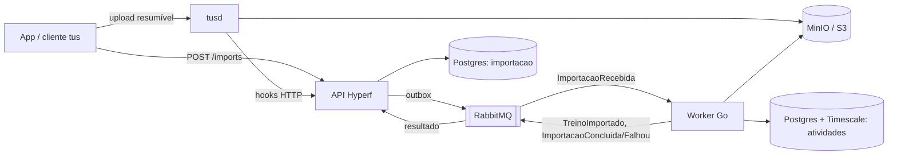

# athlete-training-platform


Plataforma de treino inteligente para atletas amadores com Apple Watch.

## O problema

Quem treina triatlo acumula dados em vários lugares: o Apple Watch (app Saúde), o ciclocomputador e plataformas de treino, cada um em um formato. Transformar isso em carga de treino comparável e em treinos ajustados ao momento do atleta é trabalho manual. A plataforma importa os treinos de todas as fontes, normaliza num modelo único, calcula métricas auditáveis e envia o plano de volta ao relógio.

**Estado atual (M1, Ingestão):** upload resumível do `export.zip` do app Saúde e de arquivos `.fit`, `.gpx` e `.tcx`, parser em streaming, gravação em lote e deduplicação. Métricas, app, planejamento e coach de IA vêm nos marcos seguintes ([design doc, seção 12](docs/design-doc.md)).

## Arquitetura



Seis contextos delimitados integrados por eventos ([ADR 0001](docs/adr/0001-contextos-delimitados-por-eventos.md)); cada serviço é hexagonal, com tradutores (ACL) isolados para cada formato externo.

### Estrutura do repositório

| Caminho | Conteúdo |
| --- | --- |
| `services/api` | API e Planejamento (PHP, Hyperf) |
| `services/ingest` | Worker de ingestão (Go) |
| `services/metrics` | Métricas (Go, M2) |
| `services/coach` | Coach de IA (TypeScript, M6) |
| `app/` | App Ionic + Vue + Capacitor (M3) |
| `plugins/capacitor-workoutkit` | Plugin Swift (M5) |
| `contracts/` | Esquemas dos eventos (JSON Schema, AsyncAPI) e OpenAPI |
| `infra/` | Init e migrações dos bancos, definições do RabbitMQ, scripts |
| `docs/` | Design doc, ADRs, issues, roteiros |

## Como rodar

Requisitos: Docker com Compose v2, make. Para os serviços: PHP 8.3 + Composer + Swoole, Go (versão do `go.mod`).

```bash
make up        # Postgres + TimescaleDB, RabbitMQ, MinIO e tusd (cria .env a partir de .env.example)
make migrate   # aplica as migrações dos bancos importacao e atividades
make ps        # estado e healthchecks
make down      # para (make clean também remove os volumes)
```

| Serviço | Endereço | Credenciais de desenvolvimento |
| --- | --- | --- |
| RabbitMQ (gestão) | http://localhost:15672 | `atp` / `dev-only-change-me` |
| MinIO (console) | http://localhost:9001 | `atp-minio` / `dev-only-change-me` |
| tusd | http://localhost:8080/files/ | |
| Postgres | `localhost:5432` (bancos `importacao`, `atividades`) | `atp` / `dev-only-change-me` |

Portas e senhas ficam em `.env` (ignorado pelo Git). A API roda no host na porta 9501 e o `tusd` chama o hook em `TUSD_HOOK_URL`.

## Como testar

```bash
make test               # unitários dos serviços presentes
make lint
make test-integration   # Testcontainers: exige Docker
make migrate-test       # sobe, confere esquema, reverte e sobe de novo, num Postgres descartável
make contracts-check    # esquemas, exemplos, OpenAPI e AsyncAPI
```

O CI (`.github/workflows/ci.yml`, workflow `CI`) roda um job por serviço, só quando o código ou `contracts/` muda (paths-filter), mais contratos e infra. Um commit de `feat/*` com CI verde é levado à `main` pelo `promote.yml`.

## Contratos

- Eventos: [`contracts/events/importacao`](contracts/events/importacao) (`ImportacaoRecebida`, `TreinoImportado`, `ImportacaoConcluida`, `ImportacaoFalhou`).
- HTTP: [`contracts/openapi/imports.yaml`](contracts/openapi/imports.yaml).
- Topologia e versionamento: [`contracts/README.md`](contracts/README.md).

## Decisões principais

| ADR | Decisão |
| --- | --- |
| [0001](docs/adr/0001-contextos-delimitados-por-eventos.md) | Contextos integrados por eventos (outbox + RabbitMQ) |
| [0002](docs/adr/0002-acl-para-fontes-e-destinos-externos.md) | ACL para toda fonte externa |
| [0003](docs/adr/0003-parser-streaming-go-export-saude.md) | Parser em streaming em Go |
| [0004](docs/adr/0004-timescaledb-para-amostras.md) | TimescaleDB para amostras |
| [0007](docs/adr/0007-hyperf-api-planejamento-go-ingestao-metricas.md) | Hyperf para a API, Go para ingestão e métricas |
| [0008](docs/adr/0008-dados-de-saude-sensiveis-lgpd.md) | Dados de saúde sensíveis (LGPD) |
| [0009](docs/adr/0009-contratos-versionados-e-um-banco-por-contexto.md) | Contratos versionados e um banco por contexto |
| [0010](docs/adr/0010-tusd-separado-com-backend-s3.md) | tusd separado com backend S3 |

## Trade-offs

- Outbox + RabbitMQ dá entrega pelo menos uma vez e isola contextos, ao custo de consistência eventual e consumidores idempotentes.
- Dois bancos no mesmo servidor reforçam a fronteira dos contextos sem multiplicar a operação em desenvolvimento.
- Duas linguagens no backend (PHP e Go) separam API transacional de processamento pesado, com mais toolchains no CI.

## Próximos passos

M2 Métricas, M3 App e HealthKit, M4 Planejamento, M5 plugin WorkoutKit, M6 Coach de IA ([plano de entrega](docs/design-doc.md)). Pendentes de decisão: autenticação e RBAC, retenção de 7 dias dos arquivos, OpenTelemetry fim a fim ([issues, pontos em aberto](docs/issues/README.md)).

## Dados e privacidade

Dados de saúde são sensíveis ([ADR 0008](docs/adr/0008-dados-de-saude-sensiveis-lgpd.md)): o repositório só contém dados sintéticos ou anonimizados.

## Roteiros do núcleo

Nenhuma issue do M1 é núcleo; os roteiros de entrevista ([`docs/roteiros/`](docs/roteiros)) nascem com as fórmulas de métricas (M2), o validador de restrições (M4) e o tradutor WorkoutKit (M5).

## Licença

[MIT](LICENSE)
