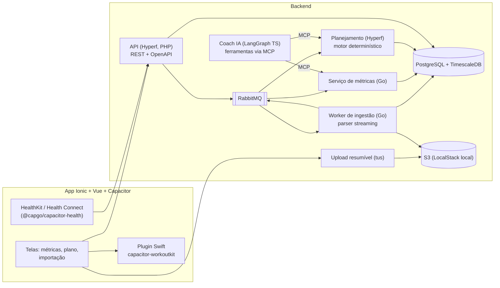
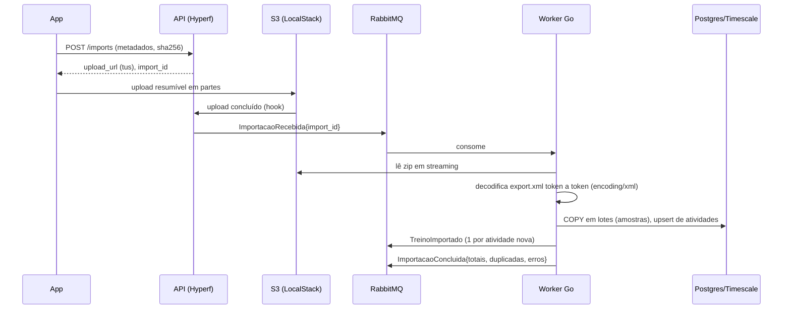
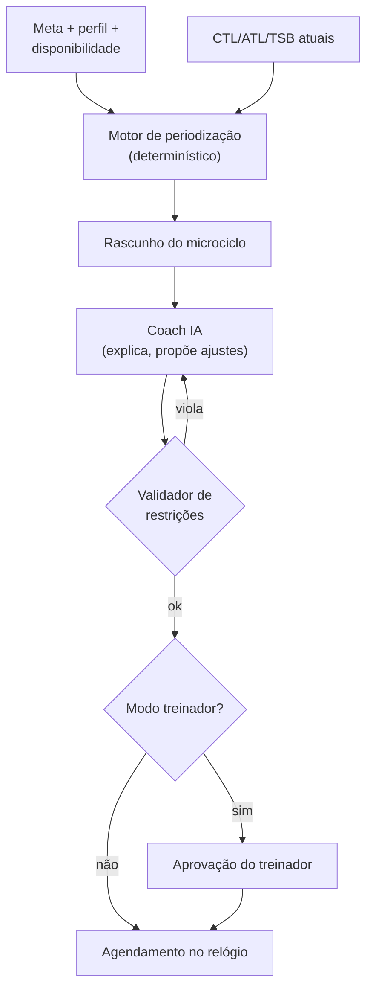

# Design Doc — Plataforma de Treino Inteligente com Apple Watch

- id: athlete-training-platform
- Status: Proposto
- Arquitetura: Clean Architecture + Hexagonal + DDD, Anti-Corruption Layer em toda fronteira com formato ou API de terceiros
- Primeiro perfil de uso: triatleta amador (natação, bike, corrida + musculação) com Apple Watch, ciclocomputador e plataformas de treino

## 1. Problema

Atletas amadores acumulam dados de treino em vários lugares (Apple Saúde, ciclocomputador, plataformas de treino) em formatos diferentes, e transformar isso em métricas comparáveis e em treinos ajustados ao momento do atleta é manual. O Apple Watch registra bem, mas não planeja; as plataformas que planejam nem sempre conversam com o relógio.

A plataforma:

- importa treinos de várias fontes e normaliza num modelo único;
- calcula métricas de carga e desempenho com fórmulas conhecidas e auditáveis;
- gera treinos e microciclos de acordo com o perfil, a meta e a carga atual do atleta;
- envia os treinos ao Apple Watch (app Workout) e exporta para outros dispositivos.

## 2. Objetivos e não-objetivos

Objetivos

- Ingestão de: export do app Saúde (export.zip), HealthKit em tempo real pelo app, arquivos .fit, .tcx e .gpx.
- Métricas: zonas, TSS por modalidade, CTL/ATL/TSB, CSS, tendência de FC de repouso, aderência ao plano.
- Gerador de treinos determinístico com camada de IA restrita (explica, ajusta dentro de limites, interpreta metas em linguagem natural).
- App híbrido Ionic + Vue + Capacitor com plugin nativo em Swift para o WorkoutKit.
- Modo treinador: o plano gerado pode exigir aprovação de um treinador antes de ir para o relógio.

Não-objetivos

- Substituir treinador ou orientação médica. O sistema não diagnostica nada e não prescreve para lesão ou condição de saúde.
- Rastrear treino ao vivo no relógio (isso é do app Workout da Apple; o projeto só envia o plano e lê o resultado).
- Rede social, ranking ou compartilhamento público.

## 3. Restrições técnicas descobertas

| Restrição | Consequência no desenho |
| --- | --- |
| Não existe API web para dados do Apple Watch; o acesso é via HealthKit no iOS ou pelo export do app Saúde | Duas portas de entrada: app (HealthKit) e upload do export.zip |
| O export do app Saúde é um .zip com export.xml (centenas de MB a GB), export_cda.xml e workout-routes/*.gpx | Parser em streaming (nunca carregar o XML inteiro), upload resumível |
| Plugins Capacitor de saúde leem treinos, mas a escrita de treinos é limitada (ex.: @capgo/capacitor-health lista workouts como somente leitura) | Leitura via plugin existente; envio de treinos via plugin próprio |
| WorkoutKit (iOS 17+/watchOS 10+) cria CustomWorkout com blocos e passos e agenda no app Workout via WorkoutScheduler | Plugin Swift capacitor-workoutkit |
| O WorkoutScheduler tem autorização própria (separada do HealthKit) e limites de quantidade e janela de agendamento (referência de terceiros: até 15 planos, ±7 dias) | Sincronização em janela deslizante; fila de agendamento no backend |
| Há relatos de falhas de sincronização do WorkoutScheduler em algumas versões beta do iOS | Fallback: openInWorkoutApp() e export .fit do treino |
| Google Fit encerra no fim de 2026; Health Connect é o substituto no Android | Android via Health Connect (mesmo plugin), sem Google Fit |
| Dados de saúde são dado pessoal sensível (LGPD) | Consentimento explícito, criptografia, minimização, exclusão real |
| Build iOS exige Mac + Xcode; distribuição exige conta Apple Developer | Documentar; CI iOS em runner macOS |

## 4. Arquitetura

### 4.1 Contextos delimitados (DDD)

| Contexto | Responsabilidade | Agregados principais | Eventos publicados |
| --- | --- | --- | --- |
| Importação | Receber arquivos e dados do HealthKit, deduplicar, normalizar | LoteDeImportacao, FonteDeDados | ImportacaoRecebida, TreinoImportado, ImportacaoFalhou |
| Atividades | Modelo canônico de treino realizado e suas séries temporais | Atividade (com Sessao, Volta, Amostra) | AtividadeRegistrada, AtividadeCorrigida |
| Métricas | Zonas, TSS, carga crônica e aguda, limiares | PerfilFisiologico, CargaDiaria | MetricasCalculadas, LimiarAtualizado |
| Atleta | Perfil, metas, disponibilidade, restrições, consentimento | Atleta, Meta, Disponibilidade | MetaDefinida, DisponibilidadeAlterada |
| Planejamento | Periodização, geração e adaptação de treinos | Plano > Mesociclo > Microciclo > TreinoPlanejado | PlanoGerado, TreinoPlanejado, PlanoAjustado |
| Sincronização | Envio a dispositivos e leitura do realizado | Agendamento, Dispositivo | TreinoEnviado, TreinoRealizado, SincronizacaoFalhou |

Integração entre contextos só por eventos (outbox → RabbitMQ) ou por consulta a read models. Nenhum contexto lê a tabela de outro.

### 4.2 Visão geral



Por que essa divisão de linguagens

- Hyperf (PHP, corrotinas): API e Planejamento. Prova pública de Hyperf, que aparece no seu LinkedIn sem evidência hoje.
- Go: parsing de arquivos grandes em streaming e cálculo de métricas em lote (CPU e memória previsíveis).
- TypeScript + LangGraph: camada de IA, reutilizando o padrão do agente de posicionamento.
- Swift: plugin nativo do WorkoutKit.

### 4.3 Hexagonal por serviço

```text
src/
  Domain/          # entidades, value objects, eventos, regras puras (sem framework)
  Application/     # casos de uso, portas (interfaces) de entrada e saída
  Infrastructure/
    Persistence/   # repositórios Postgres
    Messaging/     # outbox, publisher/consumer RabbitMQ
    Acl/           # tradutores de formatos e APIs externas
  Interfaces/      # HTTP (controllers), CLI, consumers
```

### 4.4 Anti-Corruption Layer

Cada fonte externa tem um tradutor isolado em Infrastructure/Acl/, com testes de contrato usando arquivos reais anonimizados.

| Fonte externa | Tradutor | Para o modelo de domínio |
| --- | --- | --- |
| export.xml do app Saúde (Workout, Record, WorkoutRoute) | AppleHealthExportTranslator | Atividade, Amostra (FC, potência, cadência, velocidade) |
| HealthKit via plugin (JSON do Capacitor) | HealthKitPluginTranslator | Atividade |
| .fit (Garmin SDK; Wahoo e outros) | FitTranslator | Atividade, Volta, Amostra |
| .tcx / .gpx | TcxTranslator, GpxTranslator | Atividade, Rota |
| WorkoutKit (saída) | WorkoutKitPlanTranslator | de TreinoPlanejado para CustomWorkout / SwimBikeRunWorkout |
| .fit workout (saída) | FitWorkoutTranslator | de TreinoPlanejado para arquivo de treino estruturado |
| Intervals.icu (opcional, API com chave pessoal; conferir termos) | IntervalsIcuTranslator | importação de atividades e exportação de treinos |

Regras da ACL:

- Unidades sempre convertidas na fronteira (m/s, W, bpm, metros, segundos, UTC).
- Tipos de atividade de terceiros mapeados para um enum de domínio (Natacao(piscina|aguas_abertas), Ciclismo(indoor|outdoor), Corrida, Forca, Outro); tipo desconhecido vira Outro com o original preservado em metadado.
- Nenhuma classe de biblioteca de terceiros atravessa a porta.

## 5. Ingestão

### 5.1 Fluxo do export.zip



Decisões

- Streaming de ponta a ponta: archive/zip + xml.Decoder.Token(); memória constante independentemente do tamanho do export.
- Idempotência: chave natural por atividade = hash(fonte, inicio_utc, duracao, tipo, dispositivo); reimportar o mesmo export não duplica nada.
- Deduplicação entre fontes: o mesmo treino pode vir do relógio e do ciclocomputador. Regra: sobreposição de tempo acima de 80% e mesmo tipo → manter a fonte com mais canais de dados (ex.: potência), registrar a outra como FonteAlternativa.
- Escrita em lote: COPY no Postgres para amostras; hypertable no TimescaleDB particionada por tempo.
- Importação incremental pelo app: âncora do HealthKit (somente o que mudou desde a última sincronização).

### 5.2 Modelo de dados (resumo)

```sql
CREATE TABLE atividade (
  id              uuid PRIMARY KEY,
  atleta_id       uuid NOT NULL,
  tipo            text NOT NULL,           -- enum de domínio
  inicio_utc      timestamptz NOT NULL,
  duracao_s       integer NOT NULL,
  distancia_m     numeric,
  chave_natural   text NOT NULL,
  fonte           text NOT NULL,           -- apple_export | healthkit | fit | tcx | gpx | intervals
  metadados       jsonb NOT NULL DEFAULT '{}',
  UNIQUE (atleta_id, chave_natural)
);

CREATE TABLE amostra (
  atividade_id uuid NOT NULL,
  ts           timestamptz NOT NULL,
  fc_bpm       smallint,
  potencia_w   smallint,
  cadencia     smallint,
  velocidade   real,      -- m/s
  altitude_m   real
);
SELECT create_hypertable('amostra', 'ts');

CREATE TABLE carga_diaria (
  atleta_id uuid NOT NULL,
  dia       date NOT NULL,
  tss       numeric NOT NULL,
  ctl       numeric NOT NULL,
  atl       numeric NOT NULL,
  tsb       numeric NOT NULL,
  PRIMARY KEY (atleta_id, dia)
);

```

## 6. Métricas

Todas as fórmulas ficam em Domain/ do serviço de métricas, com testes que usam valores de referência calculados à mão.

| Métrica | Fórmula | Entrada necessária |
| --- | --- | --- |
| Potência normalizada (NP) | raiz quarta da média de (média móvel de 30 s da potência)⁴ | potência |
| Intensity Factor (IF) | NP / FTP | NP, FTP |
| TSS (bike, potência) | (s × NP × IF) / (FTP × 3600) × 100 | NP, IF, FTP |
| rTSS (corrida) | análogo ao TSS usando pace normalizado pelo relevo e pace de limiar | velocidade, altitude, pace de limiar |
| sTSS (natação) | IF³ × horas × 100, com IF = velocidade normalizada / CSS | velocidade, CSS |
| TRIMP (Banister), quando só há FC | min × ΔFC × 0,64 × e^(1,92 × ΔFC); ΔFC = (FCmédia − FCrepouso) / (FCmáx − FCrepouso) (coeficientes femininos: 0,86 e 1,67) | FC |
| CSS (natação) | (400 − 200) / (t₄₀₀ − t₂₀₀), em m/s | dois tiros de teste |
| CTL (carga crônica) | CTLₜ = CTLₜ₋₁ + (TSSₜ − CTLₜ₋₁) / 42 | TSS diário |
| ATL (carga aguda) | ATLₜ = ATLₜ₋₁ + (TSSₜ − ATLₜ₋₁) / 7 | TSS diário |
| TSB (forma) | CTLₜ₋₁ − ATLₜ₋₁ | CTL, ATL |
| Aderência | TSS realizado / TSS planejado por sessão e por semana | plano e realizado |

Regras de qualidade de dado

- Amostras de FC fora de 30–230 bpm e potência acima de 2.500 W são descartadas e contadas.
- Lacunas maiores que 30 s não são interpoladas para NP.
- Limiar (FTP, pace de limiar, CSS) é versionado no tempo: o TSS de uma atividade usa o limiar vigente na data dela.
- Recalcular CTL/ATL é idempotente: correção de uma atividade antiga dispara recálculo da data em diante (evento AtividadeCorrigida).

## 7. Geração de treinos

### 7.1 Princípio: motor determinístico + IA com rédea curta

O plano é gerado por um motor determinístico (regras de periodização, verificáveis e testáveis). A IA não inventa carga: ela interpreta, explica e propõe ajustes que o motor valida antes de aceitar.



### 7.2 Motor de periodização

- Estrutura: Plano → Mesociclo (base, construção, pico, polimento, transição) → Microciclo (semana) → TreinoPlanejado → Bloco → Passo.
- Passo tem objetivo (tempo, distância ou aberto) e alvo (zona de FC, faixa de potência, faixa de pace ou % do CSS) e um tipo (aquecimento, trabalho, recuperação, desaquecimento).
- Entradas: data da prova-alvo e distâncias, horas disponíveis por dia e modalidade, piscina disponível (comprimento por dia, ex.: 20 m e 12,5 m), dias fixos de musculação, CTL atual e limiares.
- Distribuição de intensidade: padrão polarizado (cerca de 80% baixa, 20% moderada/alta) configurável.
- Progressão: aumento de CTL limitado por semana; semana de descarga a cada 3 ou 4 semanas.

### 7.3 Validador de restrições (código, não prompt)

| Regra | Padrão (configurável) |
| --- | --- |
| Rampa de CTL por semana | ≤ 5 pontos |
| TSB mínimo antes de sessão de alta intensidade | ≥ −25 |
| Dias consecutivos de alta intensidade | ≤ 2 |
| Pelo menos 1 dia de descanso ou recuperação ativa por semana | obrigatório |
| Volume semanal ≤ disponibilidade declarada | obrigatório |
| Musculação não no mesmo dia de sessão de limiar de corrida | preferencial |
| Atleta marcou dor ou lesão | bloqueia geração; mostra recomendação de procurar profissional |

### 7.4 Coach IA (LangGraph, TypeScript)

- Ferramentas (MCP): get_athlete_profile, get_load_history, get_plan, propose_adjustment, explain_session.
- Não tem ferramenta de escrita direta: propose_adjustment devolve uma proposta que passa pelo validador e, se ativo, pelo treinador.
- Casos de uso:
  - meta em linguagem natural → restrições estruturadas ("quero fazer meio Ironman em dezembro de 2027, treino 8 horas por semana");
  - explicar o porquê de cada sessão;
  - reorganizar a semana quando o atleta perde treinos ou relata cansaço;
  - resumo semanal da carga e da aderência.
- Guardrails: saída validada por Zod; nada de conselho médico; menção a dor, lesão ou sintoma leva a uma resposta padrão de procurar profissional e bloqueia ajustes de intensidade.

## 8. App híbrido e plugin WorkoutKit

### 8.1 App

- Stack: Ionic + Vue 3 + Capacitor 8 + Pinia + TanStack Query.
- Leitura de saúde: @capgo/capacitor-health (HealthKit no iOS, Health Connect no Android).
- Telas: importação (status do lote, duplicadas, erros), métricas (CTL/ATL/TSB, zonas, aderência), plano (semana com sessões), detalhe da sessão (passos e alvos), configurações de privacidade (consentimento, exportar e apagar dados).
- Offline-first: plano da semana em cache local; reenvio de leituras quando a conexão volta.

### 8.2 Plugin capacitor-workoutkit (Swift)

API TypeScript proposta:

```ts
export interface WorkoutKitPlugin {
  requestAuthorization(): Promise<{ status: 'authorized' | 'denied' | 'notDetermined' }>;
  schedule(options: { plan: PlannedWorkoutDTO; date: string /* ISO local */ }): Promise<{ id: string }>;
  listScheduled(): Promise<{ items: { id: string; date: string; name: string }[] }>;
  remove(options: { id: string }): Promise<void>;
  removeAll(): Promise<void>;
  openInWorkoutApp(options: { plan: PlannedWorkoutDTO }): Promise<void>;
}
```

- PlannedWorkoutDTO é o contrato estável entre app e plugin; o tradutor WorkoutKitPlanTranslator (lado Swift) monta CustomWorkout (blocos com passos de trabalho e recuperação, alvos e alertas) ou SwimBikeRunWorkout (sessões multiesporte).
- Janela deslizante: o backend mantém a fila; o app agenda no relógio apenas os próximos dias permitidos e reabastece a cada abertura e em background fetch.
- Fallback: se o agendamento falhar, openInWorkoutApp() ou export .fit.
- Testes: unitários em Swift (XCTest) para o tradutor; o agendamento real exige iPhone e Apple Watch físicos (documentar um roteiro de teste manual).
- Publicação: o plugin vira um pacote npm próprio, com README e exemplo. É uma contribuição open source concreta.

## 9. Segurança e privacidade (LGPD)

- Dados de saúde são dado pessoal sensível: consentimento explícito e granular por tipo de dado, revogável.
- Criptografia em trânsito (TLS) e em repouso (disco e backups); segredos no Vault.
- Arquivos de importação apagados do armazenamento após processamento bem-sucedido (retenção configurável, padrão 7 dias).
- Exclusão real: "apagar minha conta" remove atividades, amostras, planos e arquivos; registro de auditoria sem dado de saúde.
- Autorização por atleta (RBAC: atleta, treinador vinculado, admin); treinador só vê atletas que o convidaram.
- Desenvolvimento e testes usam apenas dados sintéticos ou anonimizados; dados reais do autor ficam locais e fora do Git.

## 10. Observabilidade

- OpenTelemetry em todos os serviços; trace único do upload até ImportacaoConcluida.
- Métricas: duração da ingestão por MB, amostras descartadas, duplicadas detectadas, tempo de recálculo de carga, taxa de sucesso do agendamento no relógio.
- SLOs: 95% das importações de até 500 MB processadas em menos de 5 min; 99% dos recálculos de carga em menos de 2 s.

## 11. Testes e evals

| Tipo | O quê |
| --- | --- |
| Unidade (domínio) | Fórmulas de métricas com valores de referência; regras do validador |
| Contrato (ACL) | Cada tradutor com arquivos reais anonimizados (export.xml reduzido, .fit de bike, .gpx de corrida, natação em piscina) |
| Integração | Testcontainers (Postgres/Timescale, RabbitMQ); CI com LocalStack pelo compose |
| Carga | Export sintético de 1 GB: memória constante e tempo dentro do SLO |
| Propriedades | Reimportação idempotente; recálculo de CTL após correção dá o mesmo resultado que cálculo do zero |
| Evals do Coach IA | 30 cenários (semanas perdidas, cansaço, meta irreal, relato de dor): % de propostas aceitas pelo validador, 0 conselhos médicos, recusa correta quando há dor |
| App | Vitest + Testing Library; E2E com Playwright na versão web; roteiro manual no aparelho para o WorkoutKit |

## 12. Plano de entrega

- M1 Ingestão: upload resumível, parser streaming do export.zip, tradutores FIT/GPX/TCX, deduplicação.
- M2 Métricas: zonas, TSS por modalidade, CTL/ATL/TSB, limiares versionados, tela de métricas.
- M3 App + HealthKit: app Ionic com leitura incremental do HealthKit e Health Connect.
- M4 Planejamento: motor de periodização, validador, export .fit de treino.
- M5 Plugin WorkoutKit: plugin Swift, janela deslizante, fallback; publicação do plugin no npm.
- M6 Coach IA: LangGraph + MCP, modo treinador, evals.

## 13. ADRs iniciais

| ADR | Decisão |
| --- | --- |
| A-01 | Seis contextos delimitados integrados por eventos (outbox + RabbitMQ) |
| A-02 | ACL para toda fonte e destino externo; nenhum tipo de terceiro no domínio |
| A-03 | Parser em streaming (Go) para o export do app Saúde |
| A-04 | TimescaleDB para amostras; Postgres comum para o resto |
| A-05 | Motor de periodização determinístico; IA só propõe, o validador decide |
| A-06 | Plugin Capacitor próprio em Swift para o WorkoutKit, publicado como open source |
| A-07 | Hyperf para API e Planejamento; Go para ingestão e métricas |
| A-08 | Dados de saúde tratados como sensíveis (LGPD): consentimento, criptografia, retenção curta de arquivos |

## 14. Modo par (núcleo seu)

- Fórmulas de métricas e testes de referência (seção 6).
- Regras do validador de restrições (seção 7.3).
- Tradutor WorkoutKitPlanTranslator em Swift.

## 15. Riscos

| Risco | Mitigação |
| --- | --- |
| Instabilidade do WorkoutScheduler em algumas versões do iOS | Fallback openInWorkoutApp() e .fit; métrica de sucesso do agendamento |
| Export do app Saúde muda de formato sem aviso | Tradutor isolado na ACL + testes de contrato; versão do formato registrada no lote |
| Plano gerado inadequado ou arriscado | Validador determinístico, modo treinador, bloqueio quando há relato de dor |
| Vazamento de dado de saúde | Criptografia, RBAC, retenção curta, apenas dados sintéticos em desenvolvimento |
| Dependência de Mac e aparelhos físicos para o iOS | Separar plugin e app; CI iOS em runner macOS; roteiro manual de teste |

## 16. Cursos que o projeto exercita (courses.yaml)

fc4-arch-hexagonal, fc4-ddd-events, fc4-msg-rabbitmq, fc4-sql-postgres, fc4-tests-advanced, fc4-tests-testcontainers, fc4-apis-design, fc4-sec-authz, fc4-sec-owasp-vault, fc4-docker-prod, un-4.3, un-4.6, un-4.7, un-8.m4, un-9.m5, un-10.riscos, un-6.1, un-05
