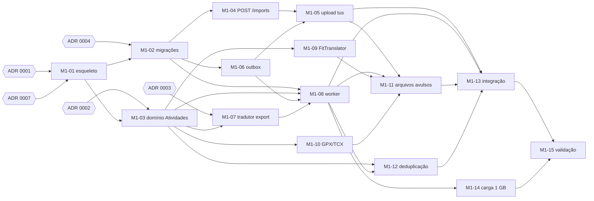

# athlete-training-platform · M1 Ingestão: ordem de execução

**Escopo (design doc, seção 12):** upload resumível, parser streaming do export.zip, tradutores FIT/GPX/TCX, deduplicação.

**Critério de pronto proposto** (o design doc não traz um explícito; precisa de aprovação): um export.zip sintético e arquivos .fit, .gpx e .tcx anonimizados enviados pela API viram atividades e amostras no Postgres/Timescale; reimportar não duplica; o mesmo treino de duas fontes vira uma atividade principal e uma `FonteAlternativa`; o export sintético de 1 GB roda com memória constante e o de 500 MB em menos de 5 min (M1-13, M1-14, M1-15).

## ADRs que o M1 usa (status Proposto)

| ADR | Decisão | Bloqueia |
| --- | --- | --- |
| [0001](../adr/0001-contextos-delimitados-por-eventos.md) (A-01) | Contextos integrados por eventos (outbox + RabbitMQ) | M1-01, M1-06 |
| [0002](../adr/0002-acl-para-fontes-e-destinos-externos.md) (A-02) | ACL para toda fonte externa | M1-03, M1-07, M1-09, M1-10 |
| [0003](../adr/0003-parser-streaming-go-export-saude.md) (A-03) | Parser em streaming em Go | M1-07 |
| [0004](../adr/0004-timescaledb-para-amostras.md) (A-04) | TimescaleDB para amostras | M1-02 |
| [0007](../adr/0007-hyperf-api-planejamento-go-ingestao-metricas.md) (A-07) | Hyperf para a API; Go para ingestão | M1-01 |
| [0008](../adr/0008-dados-de-saude-sensiveis-lgpd.md) (A-08) | Dados de saúde sensíveis; só dados sintéticos ou anonimizados no repositório | todas (fixtures) |

## Issues

| Id | Título | core | curso | Depende de | Estimativa |
| --- | --- | --- | --- | --- | --- |
| [M1-01](M1-01-esqueleto-e-ambiente-local.md) | Esqueleto do repositório e ambiente local | false | fc4-docker-prod | ADRs 0001, 0007 | 1 dia |
| [M1-02](M1-02-migracoes-importacao-e-atividades.md) | Migrações de Importação e Atividades | false | fc4-sql-postgres | M1-01, ADR 0004 | ½ dia |
| [M1-03](M1-03-dominio-atividades.md) | Modelo de domínio de Atividades | false | fc4-ddd-events | M1-01, ADR 0002 | 1 dia |
| [M1-04](M1-04-api-criar-importacao.md) | API: `POST /imports` e OpenAPI | false | fc4-apis-design | M1-02 | 1 dia |
| [M1-05](M1-05-upload-resumivel-tus.md) | Upload resumível (tus) e hook de conclusão | false | fc4-sec-owasp-vault | M1-04, M1-06 | 1 dia |
| [M1-06](M1-06-outbox-e-eventos-de-importacao.md) | Outbox e eventos de Importação no RabbitMQ | false | fc4-msg-rabbitmq | M1-02, ADR 0001 | 1 dia |
| [M1-07](M1-07-tradutor-export-apple-saude.md) | `AppleHealthExportTranslator` em streaming | false | fc4-arch-hexagonal | M1-03, ADRs 0002, 0003 | 1 dia |
| [M1-08](M1-08-worker-de-ingestao.md) | Worker de ingestão: consumo, `COPY` e eventos | false | fc4-sql-postgres | M1-02, M1-03, M1-06, M1-07 | 1 dia |
| [M1-09](M1-09-tradutor-fit.md) | `FitTranslator` | false | fc4-arch-hexagonal | M1-03 | 1 dia |
| [M1-10](M1-10-tradutores-gpx-tcx.md) | `GpxTranslator` e `TcxTranslator` | false | fc4-tests-advanced | M1-03 | 1 dia |
| [M1-11](M1-11-importacao-de-arquivos-avulsos.md) | Importação de .fit, .gpx e .tcx avulsos | false | fc4-apis-design | M1-05, M1-08, M1-09, M1-10 | ½ dia |
| [M1-12](M1-12-deduplicacao-entre-fontes.md) | Deduplicação entre fontes | false | fc4-tests-advanced | M1-03, M1-08 | 1 dia |
| [M1-13](M1-13-integracao-ponta-a-ponta.md) | Integração ponta a ponta com Testcontainers | false | fc4-tests-testcontainers | M1-05, M1-08, M1-11, M1-12 | 1 dia |
| [M1-14](M1-14-carga-export-1gb.md) | Carga com export sintético de 1 GB | false | fc4-tests-advanced | M1-08 | 1 dia |
| [M1-15](M1-15-validacao-m1.md) | Validação do critério de pronto | false | — | M1-13, M1-14 | ½ dia |

## O que é core e o que não é

O núcleo do autor neste projeto (`plan.yaml`: `formulas-de-metricas`, `validador-de-restricoes`, `tradutor-workoutkit`; seção 14 do design doc) cai no M2, M4 e M5. **Nenhuma issue do M1 é core**: o agente implementa todas. O modo par continua ligado no projeto e volta a valer a partir do M2.

## Ordem e paralelismo

1. **Onda 0 (autor):** revisar e aceitar os ADRs 0001, 0002, 0003, 0004, 0007 e 0008, e responder aos pontos em aberto abaixo.
2. **Onda 1:** M1-01.
3. **Onda 2, em paralelo:** M1-02, M1-03.
4. **Onda 3, em paralelo:** M1-04, M1-06, M1-07, M1-09, M1-10.
5. **Onda 4, em paralelo:** M1-05, M1-08.
6. **Onda 5, em paralelo:** M1-11, M1-12, M1-14.
7. **Onda 6:** M1-13.
8. **Onda 7:** M1-15.

Caminho crítico: M1-01 → M1-03 → M1-07 → M1-08 → M1-12 → M1-13 → M1-15, cerca de 6,5 dias.

## Fora do M1 (não quebrar)

- Regras de qualidade de dado (descarte de FC e potência fora da faixa), métricas e `carga_diaria`: M2.
- Leitura incremental do HealthKit pelo app (âncora) e `HealthKitPluginTranslator`: M3.
- Intervals.icu (opcional): sem marco no design doc.
- OpenTelemetry com trace do upload até `ImportacaoConcluida` (seção 10): sem marco definido; ver pontos em aberto.
- Retenção de 7 dias dos arquivos, consentimento, exclusão real e RBAC (seção 9): sem marco definido; ver pontos em aberto.

## Pontos em aberto para o autor

1. Qual serviço é dono das tabelas de Atividades (o worker Go escreve nelas no M1)? Hoje Importação e Atividades parecem morar no mesmo worker.
2. Autenticação no M1: a issue M1-04 supõe um atleta sintético fixo em desenvolvimento.
3. Implementação do servidor tus (separado com backend S3, ou dentro do Hyperf).
4. Formato do contrato de eventos entre Hyperf e Go (M1-06 supõe JSON Schema em `contracts/events/`).
5. Deduplicação: base da sobreposição, critério de desempate, `FonteAlternativa` como tabela ou metadado e efeito em eventos já publicados.
6. `Rota` não tem tabela na seção 5.2.
7. Em que marco entram observabilidade (seção 10) e as regras de LGPD da seção 9.

## Decisões do autor

- (pendente) Aprovar as issues e aceitar os ADRs.
